<div align="center">

# 🎬 H3ZeroStudio

**Таймлайн-редактор в стиле CapCut для MiniMax H3 прямо внутри ComfyUI**

Длинные ролики из отрезков, у каждого свой промпт и референсы. Отрезки продолжают друг друга без швов, а персонажи остаются теми же.

[](LICENSE)
[](https://github.com/comfyanonymous/ComfyUI)
[](#-модели)
[](#)
[](#-тесты)

[Возможности](#-возможности) · [Установка](#-установка) · [Модели](#-модели) · [Как пользоваться](#-как-пользоваться) · [Горячие клавиши](#-горячие-клавиши) · [FAQ](#-faq) · [English](#-english) · [Благодарности](#-благодарности-и-лицензии)

</div>

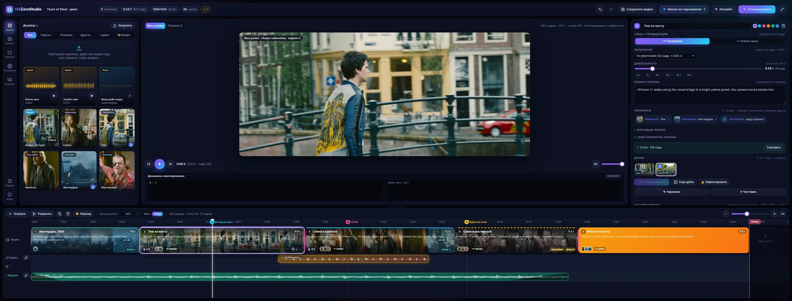

<p align="center"><i>Редактор на 21:9 (3389×1288): ассеты, плеер, карточка отрезка, таймлайн с дублями, маркерами, дорожкой «Аудио» и «Музыка».</i></p>

<table>
<tr>
<td width="50%">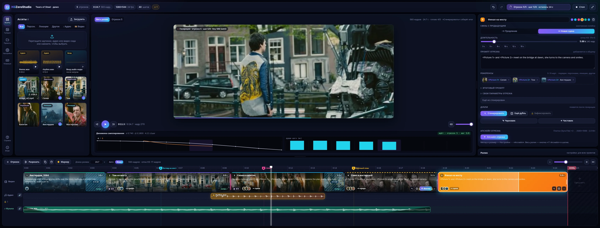<br><sub><b>Генерация:</b> живое превью шага (taeh3), графики σ / Δ, статус в шапке</sub></td>
<td width="50%">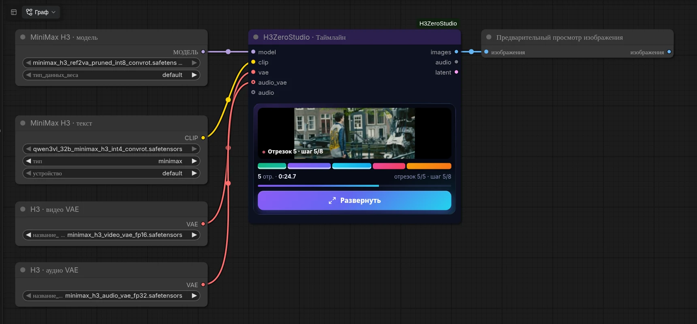<br><sub><b>На графе:</b> компактная нода с превью, полосой отрезков и прогрессом</sub></td>
</tr>
</table>

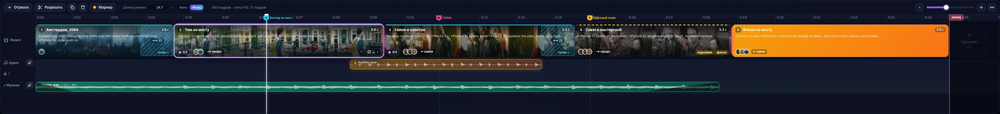

---

## ✨ Возможности

- 🎞️ **Таймлайн как в видеоредакторе.**
  - Отрезки, линейка, плейхед, масштаб от 1/16 до 64×.
  - Длина меняется по сетке H3 **17k+5** кадров.
  - Разрезать, дублировать и продлить. Шов между клипами тянется (roll edit, с `Shift` — ripple).
  - Миниатюры кадров и скраб-превью при наведении.
- 🔗 **Продление без швов.**
  - Хвост латента предыдущего отрезка фиксируется в начале следующего.
  - Последний кадр идёт референсом, звук продолжается через нативную audio denoise mask H3.
  - «Новая сцена» — обычная монтажная склейка.
- 🖼️ **Ассеты и референсы.**
  - Категории: персонажи, локации, прочее, аудио.
  - Перетаскивание на клип и Ctrl+V.
  - Автонумерация `<Picture N>`, лимит H3 — 9 картинок на отрезок.
- ✎ **Редактор промпта.** Кнопка «✎ Редактировать» у каждого поля промпта открывает большое окно (CodeMirror 6):
  - `@` — список референсов этого промпта с миниатюрами, вставляет `<Picture N>` / `<Video N>` / `<Audio N>`; метки подсвечены, несуществующие помечены;
  - поиск/замена (Ctrl+F / Ctrl+H), отмена/повтор, перенос, номера строк, моноширинный шрифт, размер, счётчик слов/символов/токенов;
  - панель «Структура H3» (subject_definitions → non_diegetic_music) с пояснениями, счётчиком слов detailed_description (350–500) и «Вставить шаблон»;
  - Ctrl+Enter — применить, Esc — отмена.
- 🎭 **Дубли (takes).**
  - До 12 вариантов на отрезок. Выбранный дубль идёт в склейку и в продолжение.
  - Изменившиеся зависимые отрезки помечаются «изменён».
- 🎵 **Звук.**
  - Дорожка **«Аудио»** фиксирует звук: видео подстраивается под ритм и липсинк.
  - Дорожка **«Музыка»** — фон, который подмешивается в итог.
  - Стыки сшиваются с точностью до сэмпла.
- ✎/✦ **Два этапа.** Быстрый черновик в малом размере, затем чистовик: латентный апскейл и короткая доработка с сохранением звука 1:1.
- ↑ **Апскейл отрезка и всего ролика.** Обученный латентный апскейлер H3, RTX Video Super Resolution или синхронные плитки (SyncTile). Размер задаётся в мегапикселях. Длинные клипы обрабатываются по кускам по времени, поэтому хватает 12 ГБ VRAM.
- ✂ **Пересоздать участок.** Кнопка «✂ Участок» над таймлайном: выделите кусок в середине клипа (сгенерированного или футажа), и пересоздастся только он. Видео и звук до и после остаются контекстом, швы — кадр в кадр и сэмпл в сэмпл, у участка свои дубли.
- 👁️ **Живое превью** каждого шага через tiny VAE `taeh3` со звуком, графики σ / Δ и время шага.
- ⛶ **Во весь экран и «Удобный просмотр».** Плеер разворачивается на весь экран (F). «Удобный просмотр» для сборки ролика, клипа или файла из галереи: масштаб вписать / ×1 / ×2 / ×4 и колесом у курсора, перетаскивание, шаг по кадрам с таймкодом, скорость 0.25–2×, петля, чёткие пиксели.
- 📌 **Маркеры.** Заметка, событие `At 3.2s: …`, усиление персонажа. Маркер конца ролика обрезает итог ровно по нему.
- 🗂️ **Галерея и проекты.**
  - Все результаты с фильтрами и избранным. Варианты одного видео (черновик, финал, апскейлы, дубли, участки) собраны в одну стопку, клик открывает её как папку.
  - A/B-сравнение с синхронным воспроизведением и увеличением ×1/×2/×4: A и B увеличиваются и сдвигаются вместе.
  - Проекты сохраняются автоматически; есть экспорт и импорт zip с ассетами.
- 〰 **Качество швов.** После генерации каждый стык оценивается (шов незаметен / лёгкий скачок / резкий шов, плюс скачок громкости) — точка над стыком, карточка клипа и галерея подсказывают, где сделать «Ещё дубль». Жёсткие склейки звука без щелчков (затухание ~5 мс), все MP4 в BT.709, настраиваемый запас VRAM во время генерации. Яркость и цвет на стыках-продолжениях выравниваются по готовым кадрам (окно 12 кадров с каждой стороны, настраивается; кэш и дубли не трогаются), оценка показывает «до → после».
- 🗂 **Проект в одной папке.** Все файлы проекта — загруженные ассеты (одинаковые хранятся один раз), их обработанные версии, постеры видео, генерации, кэш, дубли, галерея и экспорт по умолчанию — в `output/h3zerostudio/<id проекта>/`. Старые проекты при открытии копируют туда свои общие файлы (оригиналы не трогаются, кэш не сбрасывается); дублирование и zip берут ассеты с собой; удаление с галочкой «Удалить все файлы проекта» показывает размер и удаляет папку; «Очистить неиспользуемое» убирает общие остатки старых версий.
- 📦 **Пресеты моделей и LoRA.** База (diffusion model + dtype или чекпойнт), энкодер, VAE и список LoRA с силами для модели и энкодера — в общей библиотеке; пресет на проект и при желании свой у клипа; подключённые провода важнее. Модели кэшируются между запусками, смена LoRA не перечитывает базу. Файлы и силы LoRA входят в ключ кэша только при пресете; любое изменение объяснено в логе промаха и в «↺ Восстановить». Вкладка «Модели» слева: панель пресетов, стек LoRA (поиск и папки models/loras, сила ▲▼, вкл/выкл, перетаскивание; раскладка по идее Pixaroma LoRA Loader, код свой) и файлы моделей.
- ↺ **Надёжный кэш и восстановление.** Готовый дубль хранится вместе с латентом, рецептом, мастер-кадрами и звуком: повторный запуск не вызывает ни модель, ни VAE, «Очистить кэш» не теряет продолжение. Референсы сравниваются по содержимому (копия / zip / пересохранение не сбрасывают кэш). На клипе «изменён» — «↺ Восстановить»: список «что изменилось» и возврат выбранных полей; причина промаха кэша — в консоли (`[H3ZS] cache miss: … reason`).
- 💾 **Кэш по хэшу параметров.** Перегенерируется только то, что изменилось. Прогресс не теряется при перезагрузке вкладки.
- 📖 **«Справка»** прямо в редакторе: 27 разделов с поиском.
- ⌨️ **Undo/Redo и горячие клавиши.**
- 🔌 **Офлайн.** Интерфейс на чистом JS/DOM, без CDN; единственная библиотека — вложенный CodeMirror 6 (MIT) для редактора промпта.

## 📦 Установка

**Рекомендуется — через ComfyUI Manager.** Откройте **Manager → Custom Nodes Manager**, найдите **H3ZeroStudio**, нажмите **Install** и перезапустите ComfyUI. Страница в реестре: [registry.comfy.org · h3zerostudio](https://registry.comfy.org/publishers/zeroleloushe/nodes/h3zerostudio).

**Или через comfy-cli:**

```bash
comfy node install h3zerostudio
```

**Вручную (git clone):**

```bash
cd ComfyUI/custom_nodes
git clone https://github.com/zeroleloushe/H3ZeroStudio.git ComfyUI-H3ZeroStudio
```

Дальше:
- **Зависимости ставить не нужно.** Используются torch, numpy, Pillow, PyAV и aiohttp, которые уже есть в ComfyUI (`requirements.txt` пустой, там только опции).
- **Нужен ComfyUI с нативной поддержкой MiniMax H3**, то есть свежая версия.
- **Перезапустите ComfyUI.** Нода появится в категории `MiniMax H3/H3ZeroStudio` под именем **«H3ZeroStudio · Таймлайн»**.

<details>
<summary>Windows (portable / Easy-Install), embedded Python</summary>

```bat
cd ComfyUI\custom_nodes
git clone https://github.com/zeroleloushe/H3ZeroStudio.git ComfyUI-H3ZeroStudio
rem опционально, для RTX VSR:
..\..\python_embeded\python.exe -m pip install nvidia-vfx
```
</details>

## 🧩 Модели

| Что | Файл | Папка | Нужно? |
|---|---|---|---|
| MiniMax H3 (модель, текстовый энкодер, video VAE, audio VAE) | штатные файлы H3 для ComfyUI | `models/diffusion_models`, `models/text_encoders`, `models/vae` | **обязательно** (без audio VAE — только видео) |
| Обученный латентный апскейлер H3 | `minimax_h3_latent_upscaler_3d_bf16.safetensors` ([HF](https://huggingface.co/LBH-123-AI/Minimax_h3_latent_Upscaler)) | `models/latent_upscale_models` | для 2 этапов и апскейла (метод по умолчанию) |
| ↳ нода апскейлера | [Comfyui_Minimax_h3_latent_Upscaler](https://github.com/LBH-123-AI/Comfyui_Minimax_h3_latent_Upscaler) (нода `MinimaxH3LatentUpscaler3D`) | `custom_nodes` | вместе с моделью |
| RTX Video Super Resolution | пакет `nvidia-vfx` (`pip install nvidia-vfx`) и видеокарта NVIDIA RTX | — | опционально: метод «качество» и запасной вариант |
| Tiny VAE для превью | `taeh3.safetensors` ([madebyollin/taehv](https://github.com/madebyollin/taehv/tree/main/safetensors)) | `models/vae_approx` | опционально: без него превью грубое (latent → RGB) |

Папки ищутся стандартно через `folder_paths`, поэтому пути из `extra_model_paths.yaml` тоже работают. Что найдено, видно в редакторе: **«Настройки» → «Модели»**.

Если для чистовика или апскейла нет ни обученного апскейлера, ни RTX VSR, генерация остановится до сэмплинга с понятной ошибкой.

## 🚀 Как пользоваться

1. **Соберите граф.**
   - Добавьте ноду **«H3ZeroStudio · Таймлайн»**.
   - Подключите `model` (можно с turbo LoRA: 4–8 шагов, CFG 1), `clip`, `vae` и `audio_vae`.
   - Вход `audio` необязателен: свой звук можно загрузить и в ассеты.
2. Нажмите **«Развернуть»** (или двойной клик по ноде). Редактор откроется на всё окно.
3. **Загрузите ассеты** — персонажей, локации, аудио — и перетащите их на клипы.
4. **Напишите промпт** каждому отрезку и выберите связь:
   - **«Продление»** продолжает предыдущий отрезок;
   - **«Новая сцена»** — монтажная склейка.
5. **Запустите.**
   - **«Сгенерировать»** (`Ctrl+Enter`) — весь ролик.
   - Кнопки на клипе: **«Сгенерировать»** / **«Ещё дубль»** — только этот отрезок.
6. **Доведите результат.** Выбирайте лучшие дубли, правьте отрезки (перегенерируется только изменённое) и делайте чистовик или апскейл.
7. **Заберите выходы ноды:**
   - `images` (24 fps);
   - `audio`;
   - `latent` — склеенный AV-латент, например для H3 Windowed Refine.

Проект целиком живёт внутри workflow, в скрытом виджете ноды: отрезки, дубли, маркеры, аудио, настройки. Копии проектов лежат в `output/h3zerostudio/_projects`.

<table>
<tr>
<td width="34%">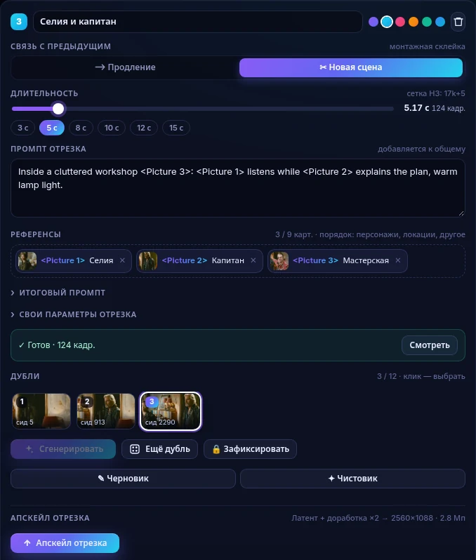<br><sub><b>Карточка отрезка:</b> связь, длительность, промпт, референсы, дубли</sub></td>
<td width="33%">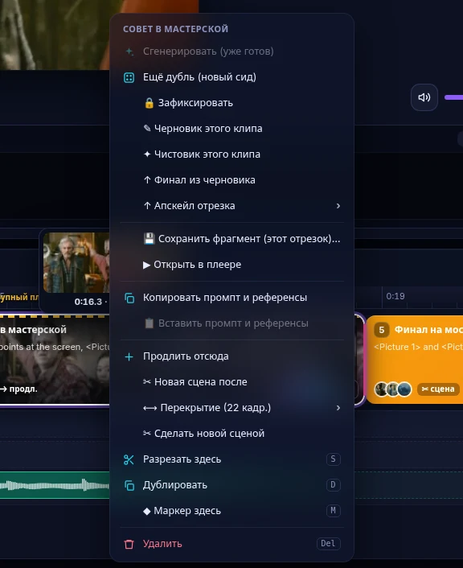<br><sub><b>Правый клик по клипу:</b> дубль, этапы, апскейл, перекрытие, маркер</sub></td>
<td width="33%">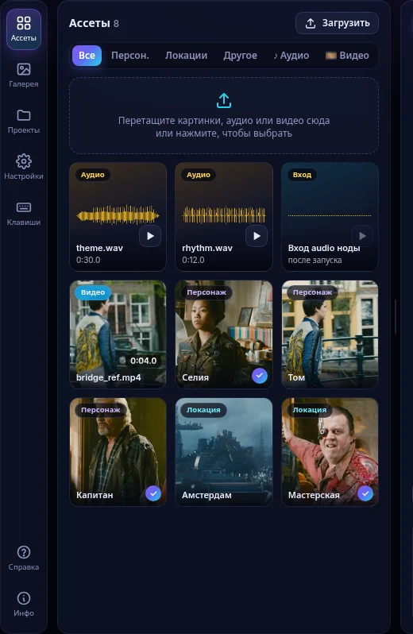<br><sub><b>Ассеты:</b> персонажи, локации, прочее, аудио с волной</sub></td>
</tr>
</table>

## ⚙️ Настройки и этапы

<table>
<tr>
<td width="50%">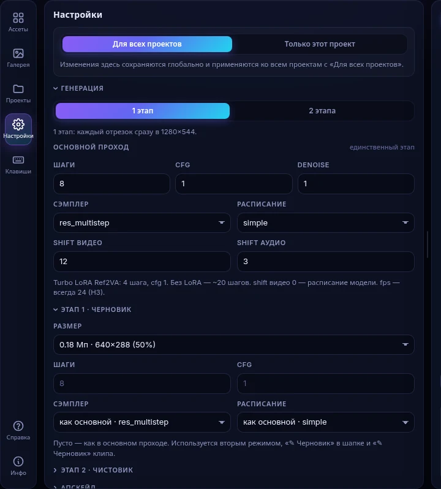</td>
<td width="50%">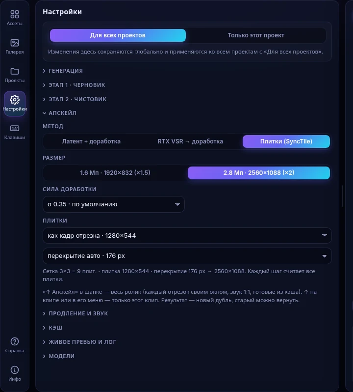</td>
</tr>
<tr><td><sub><b>«Настройки»:</b> этапы, параметры прохода, продление, кэш, превью, модели</sub></td><td><sub><b>«Апскейл»:</b> метод, итоговые Мп, σ; для плиток — сетка 3×3 и перекрытие</sub></td></tr>
</table>

**Язык интерфейса** — русский или английский: «Настройки» → 🌐 «Язык интерфейса» («Авто» — как в ComfyUI). Справка пока только на русском.

В правой панели собрано то, что меняется часто: отрезок, общий промпт, негатив, разрешение и сид. Всё остальное — во вкладке **«Настройки»**. Глобальные настройки хранятся в `output/h3zerostudio/_settings.json`. Есть два режима: «Для всех проектов» и «Только этот проект».

**Режим генерации** («Настройки» → «Генерация»):
- **1 этап** — каждый отрезок сразу в финальном размере.
- **2 этапа** — сначала черновик (по умолчанию 50 % по стороне), затем чистовик:
  1. Видео-латент выбранного черновика увеличивается обученным апскейлером H3 (или через RTX VSR → VAE encode).
  2. Короткий проход H3 стартует с **σ 0.40** (проверенный диапазон 0.25–0.45). Это доля шума, а не «denoise».
  3. **Звук черновика сохраняется 1:1** через маску звука H3, перекрытие фиксируется по доработанному предыдущему отрезку.
- **✎ Черновик / ✦ Чистовик / ↑ Финал из черновика** запускают один этап для одного клипа, не меняя режим проекта.
- У «Основного прохода», «Этапа 1» и «Этапа 2» свои шаги, cfg, сэмплер, расписание и shift. Пустое поле означает «как в основном проходе».

<details>
<summary>Подробнее: кэш, лог, перекрытие</summary>

- **Кэш.**
  - Черновики и финалы кэшируются отдельно в `output/h3zerostudio/<проект>/cache/` по хэшу параметров. Переключение режима ничего не стирает.
  - Сервер хранит состояние запуска (`/h3zero/status`). Редактор догоняет пропущенное после перезагрузки вкладки или возврата в окно.
- **Перекрытие** продлений: 22, 39, 56 … кадров (сетка 17k+5). Задаётся глобально и для каждого стыка: в карточке или через ПКМ → «Перекрытие». Значения 39/90/141 ложатся точно на сетку звука 40 Гц.
- **Лог `[H3ZS]` в консоли ComfyUI.**
  - Сводка запуска.
  - Начало каждого отрезка: seed, какой ассет стоит за каким `<Picture N>`, HIT/miss кэша.
  - Строка на каждый шаг: σ, Δ, мс, ETA, VRAM.
  - Итог склейки.
- **Оценка до запуска.** Кадры, секунды и примерное время. Предупреждения: выход за обучающий диапазон H3 (124–362 кадра), пустые промпты, маркеры без эффекта.
</details>

## ↑ Апскейл

Отрезок увеличивается и дорабатывается, остальные при этом не трогаются. Запустить можно кнопкой **↑** на клипе, через меню клипа «↑ Апскейл отрезка ▸» (метод ▸ размер в Мп) или из карточки. **«↑ Апскейл»** в шапке увеличивает весь ролик: готовые отрезки берутся из кэша, прерванный запуск продолжается.

- **Размер — в мегапикселях** («Настройки» → «Апскейл»): пресеты 1.0–4.0 Мп или свой. Рядом сразу видно итоговое W×H: пропорции проекта, стороны кратны 32. Старые ×1.5 / ×2 автоматически переводятся в Мп с тем же размером, кэш сохраняется.
- **Куски по времени.** Длинный клип не увеличивается целиком: он делится на куски ≈ N секунд (по умолчанию 5 с → 124 кадра, длина прилипает к сетке H3 17k+5) с перекрытием (по умолчанию 22 кадра). Куски идут по очереди: у каждого свой апскейл и своя доработка (с плитками внутри, если они включены), после куска VRAM освобождается. Следующий кусок продолжает чистый хвост предыдущего, как при продлении; на стыке кадры смешиваются при декодировании. Число кусков считается автоматически по длине. Логика — как в последовательном режиме собственной ноды автора ComfyUI-H3-WindowedRefine.

| Метод | Как работает | σ по умолчанию |
|---|---|---|
| **Латент + доработка** (по умолчанию) | обученный апскейлер H3 прямо в латенте, без VAE decode/encode | 0.40 |
| **RTX VSR → доработка** | decode → RTX VSR (ULTRA) → encode, вариант «качество» | 0.25 |
| **Плитки (SyncTile)** | синхронные плитки: на каждом шаге считаются все плитки со своими референсами и смешиваются рампами | 0.35 |

- Для плиток задаются размер (768×448 … 1280×704 или свой) и перекрытие. Итоговая сетка показывается сразу, например «3×3 = 9 плит. → 1728×960».
- Звук отрезка сохраняется 1:1.
- Апскейл — это обычный дубль: к версии без апскейла всегда можно вернуться.
- Прогресс виден по каждой плитке: кусок i/N, шаг, тайл, проценты и ETA (в консоли и в шапке), плюс рамка текущей плитки поверх плеера.

## ✂ Пересоздать участок

Если не нравится кусок **в середине** клипа или на стыке двух, нажмите **«✂ Участок»** на панели над таймлайном (`R`) и протяните по видеодорожке. Появится розовая рамка — то, что пересоздаётся. Голубая штриховка по бокам — контекст до и после, он не меняется. Края рамки тянутся, за ярлык рамка двигается. В карточке над таймлайном: промпт участка (подставлен промпт отрезка), референсы, сид, длина контекста до/после и кнопка **«↻ Пересоздать»**. `Esc` или повторное нажатие кнопки — выход из режима. Второй путь — меню клипа «↻ Перегенерировать участок…».

- **Как работает.** Окно H3 = контекст до + участок + контекст после. Латенты контекста (готовые клипы или закодированный футаж) остаются чистыми через нативную временную маску H3 по видео и звуку, шумится только середина. Видео вклеивается кадр в кадр. Звук — с точностью до сэмпла: смещение по корреляции на зонах контекста, выравнивание уровня, короткие переходы в самых тихих местах.
- **Мост, пролог, продолжение.** Выделение может пересекать склейку или промежуток (мост: хвост сцены до и начало следующей — контекст), начинаться в промежутке перед сценой (пролог) или заходить за её конец (продолжение). Тот же движок, тот же кэш и дубли; в режиме «2 этапа» — один финальный проход.
- **Оба шва участка** выравниваются по яркости и цвету (если включено) и получают оценку шва — точки на рамке и строка «Швы» в карточке. «↺ Восстановить» в дублях участка возвращает входы, с которыми сделан выбранный дубль.
- **Сетка H3.** Края прилипают к блокам по 17 кадров (≈0,71 с), окно всегда 17k+5 кадров; карточка показывает, что именно пересоздаётся.
- **Дубли.** Каждый результат — дубль участка: «Оригинал / 1 / 2…», можно сравнивать и возвращать. Если отрезки под участком изменились, дубль помечается «устарел» и в ролик не идёт.
- **2 этапа:** окно сначала в черновике, затем апскейл и доработка; звук черновика сохраняется.
- **Ограничения:** участок не пересекает склейку (новая сцена, граница футажа, продление без перекрытия). У края сцены контекста с той стороны нет. Окно — не больше 957 кадров, лучше 124–362.

## ◈ Персонажи (карточки)

Вкладка «Персонажи» — библиотека заранее закодированных референсов (персонаж, локация, одежда, стиль, движение, голос) в формате RefMod `.safetensors` (тот же, что у [ComfyUI-MiniMaxH3Mod](https://github.com/Luisacaotica/ComfyUI-MiniMaxH3Mod)). Карточки хранятся в одной общей библиотеке `output/h3zerostudio/_characters` (с превью) — видны во всех проектах; удаление проекта, «Очистить неиспользуемое», дублирование, zip и перенос её не трогают, проект хранит только id и подпись карточки. Файлы из `models/refmods` видны только для чтения. Файлы, добавленные в форму с диска, временно лежат в `_characters/.uploads` и удаляются после создания карточки или через сутки.

- **Создание** из ассетов проекта: фото (порядок, кадрирование — первое задаёт пропорции), необязательный клип (правило 17 кадров) и голос (обрезка, ≈80 токенов/с); Full или Compressed; описание субъекта (имя, внешность, что сохранять, голос). Перед созданием видно, сколько токенов займёт карточка.
- **Применение**: клик или перетаскивание на клип / ✂ участок. Карточка подаётся целиком после обычных референсов, метки `<Picture N>` / `<Video N>` / `<Audio N>` продолжают нумерацию; вес ×2–×4 = копии, < 1 = ослабленная; вкл/выкл, отдельно внешность и голос. Входит в ключи кэша, дубли и «Восстановить».
- **В редакторе промпта**: метки карточек в @-списке; «◈ Набросать из персонажей» заполняет `subject_definitions` / `retention_analysis`; `!Имя` → `<Subject N> Имя`; кнопки 🎙 вставляют реплику персонажа `<d>…</d>`; предупреждения о неупомянутых, выключенных и неподаваемых карточках.

## 🎵 Звук: «Аудио» (фиксация) и «Музыка»

| | Дорожки **«Аудио»** (2 полосы) | Дорожка **«Музыка»** |
|---|---|---|
| Что делает | звук **фиксируется** в аудиолатенте на всех шагах | фон, **подмешивается** к итогу при склейке |
| Видео | подстраивается под звук (ритм, липсинк, удары) | не зависит от музыки |
| Звук H3 под клипом | заменён вашим | генерируется как обычно, музыка ложится поверх |
| Для чего | клип под песню, озвучка, синхрон | саундтрек, эмбиент |

- Аудиоклипы можно двигать, подрезать за края, разрезать на плейхеде (`S`) и удалять (`Del`).
- Аудиоассет в **референсах** отрезка — это только подсказка `<Audio N>` (H3 ref_audios, до 3 на отрезок).
- **Стыки продлений:**
  - Аудиолатент перекрытия защищается маской: модель продолжает ту же музыку, голос и фон.
  - Склейка выравнивается по корреляции, с точностью до сэмпла.
  - Если по обе стороны разный звук — выравнивание громкости и равномощный кроссфейд.

## 🗂️ Галерея, проекты, справка

<table>
<tr>
<td width="50%">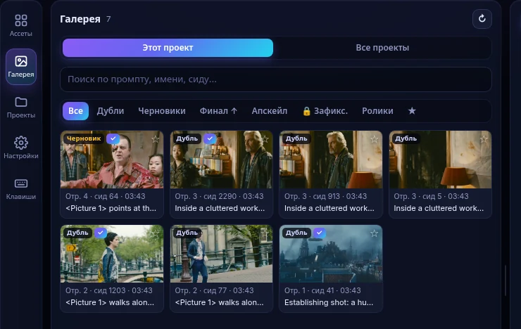</td>
<td width="50%">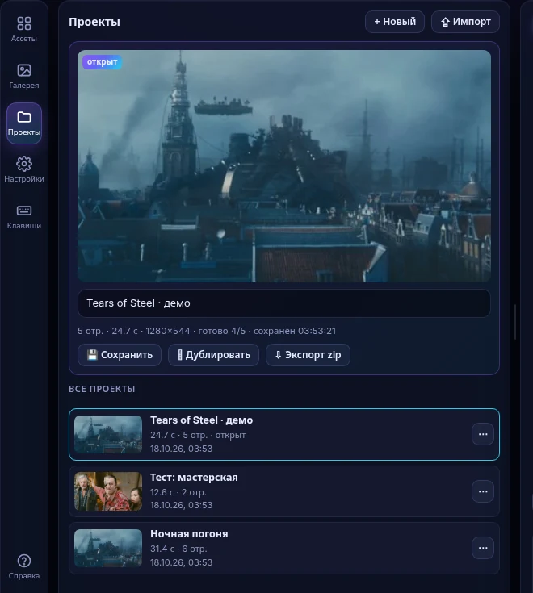</td>
</tr>
<tr><td><sub><b>Галерея:</b> стопки вариантов (черновик → финал → апскейлы, участки), фильтры, поиск, избранное, A/B (Ctrl+клик) с увеличением ×2/×4</sub></td><td><sub><b>Проекты:</b> открыть, переименовать, дублировать, экспорт/импорт zip с ассетами</sub></td></tr>
</table>

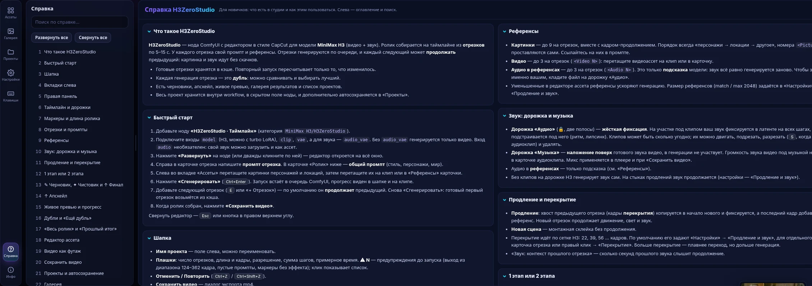

<p align="center"><sub><b>«Справка»</b>: руководство для новичков прямо в редакторе — 26 разделов, оглавление и поиск с подсветкой.</sub></p>

<details>
<summary>Ещё скриншоты: плеер, редактор ассета, сохранение</summary>

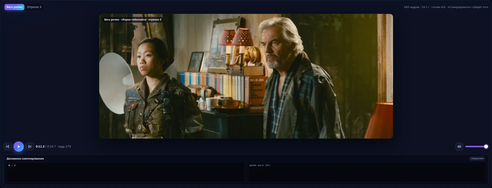

| Редактор ассета | Экспорт / сохранение |
|---|---|
| 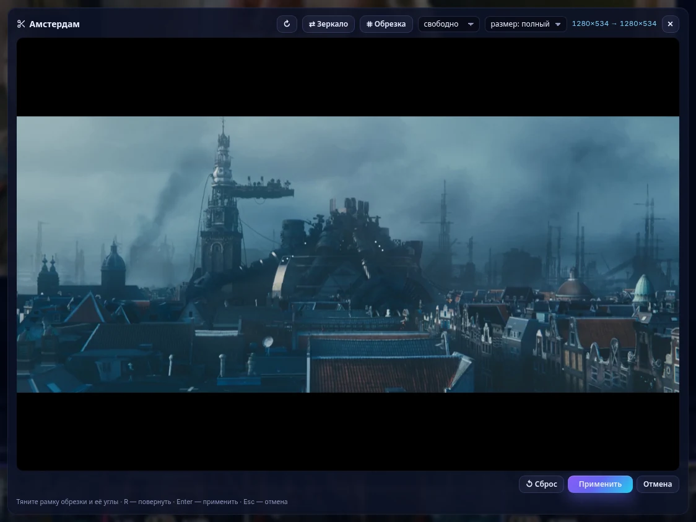 | 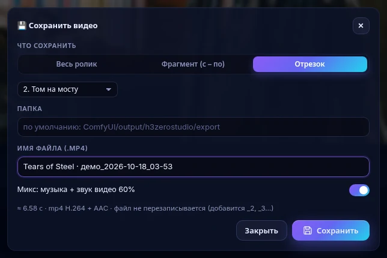 |
</details>

## ⌨️ Горячие клавиши

| Клавиша | Действие |
|---|---|
| `Пробел` | play / pause |
| `S` / `D` / `E` | разрезать / дублировать / продлить отрезок |
| `S` при выбранном аудиоклипе | разрезать аудиоклип на плейхеде |
| `M` | маркер на плейхеде |
| `R` | «✂ Участок»: выделить и пересоздать часть ролика |
| `Del` / `Backspace` | удалить отрезок или аудиоклип |
| `← →` (`Shift` — по секунде), `Home` / `End` | перемотка |
| `[` `]` | предыдущий / следующий отрезок |
| `+` `−`, `Ctrl+колесо` | масштаб таймлайна (к курсору) |
| `Ctrl+Z` / `Ctrl+Y` | отменить / повторить |
| `Ctrl+Enter` | сгенерировать |
| Правый клик по клипу | контекстное меню |
| `Shift` при перетаскивании шва | ripple вместо roll |
| `Esc` | закрыть меню / выйти из «✂ Участок» / снять выбор / свернуть редактор |

Пока открыт редактор, горячие клавиши ComfyUI (в том числе его Ctrl+Z для графа) не срабатывают.

## ❓ FAQ

<details><summary><b>«Апскейл недоступен» / чистовик не запускается</b></summary>

Нужен обученный апскейлер: нода [Comfyui_Minimax_h3_latent_Upscaler](https://github.com/LBH-123-AI/Comfyui_Minimax_h3_latent_Upscaler) и файл `minimax_h3_latent_upscaler_3d_bf16.safetensors` в `models/latent_upscale_models`. Другой вариант — `pip install nvidia-vfx` на ПК с NVIDIA RTX. Статус виден в «Настройки» → «Модели».
</details>

<details><summary><b>Превью во время генерации мутное, цвета странные</b></summary>

Положите `taeh3.safetensors` в `models/vae_approx` и выберите в «Живое превью» tiny VAE «авто». Без него используется грубое приближение latent → RGB.
</details>

<details><summary><b>Кнопки «Сгенерировать» на отрезке-продлении серые</b></summary>

Продлению нужен готовый (выбранный) дубль предыдущего отрезка: без его хвоста продолжать нечего. Сначала сгенерируйте предыдущий отрезок. Первый отрезок и «Новая сцена» доступны всегда.
</details>

<details><summary><b>У старой ноды на графе бейдж [DEPR]</b></summary>

Это workflow со старой нодой `ZL_H3Studio` (прежнее имя «H3 Studio»). Он по-прежнему загружается, а в компактном виде ноды есть кнопка **«⇪ Обновить ноду»**: она заменяет ноду на новую, сохраняя проект, связи, позицию и значения.
</details>

<details><summary><b>Где хранятся проекты и результаты? Нужен ли интернет?</b></summary>

Проект хранится внутри workflow и копией в `output/h3zerostudio/_projects`. Кэш и результаты лежат в `output/h3zerostudio/<проект>/`, ассеты — в `input/h3zerostudio/`. Интернет не нужен: интерфейс работает офлайн, без CDN.
</details>

<details><summary><b>Сколько длиной делать отрезки?</b></summary>

Держите отрезки в обучающем диапазоне H3: 124–362 кадра, это примерно 5–15 с. Длинный ролик собирайте продлениями. Отрезки генерируются последовательно.
</details>

<details><summary><b>Плитки апскейла упираются в VRAM</b></summary>

Возьмите плитку меньше (например, 768×448): плиток станет больше, но каждая легче. Итоговая сетка и размер показываются до запуска.
</details>

## 🧪 Тесты

```bash
python -m pip install pytest
python -m pytest            # или COMFYUI_PATH=/путь/к/ComfyUI python -m pytest
```

78 тестов запускают настоящий `MiniMaxH3` в крошечной конфигурации с фейковыми CLIP и VAE на CPU. Они проверяют:
- продления, кэш и перекрытие;
- аудио-фиксацию и швы;
- дубли и маркеры;
- этапы и апскейл;
- превью;
- синтаксис JS и совпадение логики Python и JS.

---

## 🇬🇧 English

**H3ZeroStudio** is a CapCut-style timeline editor node for **MiniMax H3** in ComfyUI.

The interface is available in English and Russian: «Settings» → 🌐 *Interface language* (Auto follows ComfyUI's language). The built-in help is in Russian for now.

- **Segments.** Build a long video from segments, each with its own prompt and reference images. *Extend* continues the previous segment: its latent tail is pinned and audio continues through H3's native denoise masks. *New scene* is a hard cut.
- **Takes.** Keep up to 12 takes per segment. Only changed segments are re-generated, thanks to a content-hash cache.
- **Two stages.** A fast draft first, then a final pass: learned H3 latent upscaler (or RTX VSR) plus a short low-σ refine that keeps the draft audio 1:1.
- **Upscale.** Per segment or the whole video: learned latent upscaler, RTX Video Super Resolution, or synchronized tiles (SyncTile). Footage used as is is upscaled too (VAE-encoded frames through the same mode; with RTX VSR the file's own frames, no VAE, no refine), and so are ✂ spans (bridge / prologue / region takes, right click «↑ Апскейл участка»; cached with the take, seams level-locked after the upscale). The target size is set in megapixels. Long clips are processed in sequential temporal chunks (upscale + refine per chunk, overlaps continued like an extension, VRAM freed between chunks), which keeps a 12 GB GPU in budget.
- **Regenerate a range.** The «✂ Участок» toolbar button selects a range in the middle of a clip (generated or footage). Only that range is re-sampled; the video and audio before and after it stay as clean context (H3's native per-modality temporal mask). The result is spliced back frame-exactly and sample-exactly, and each result is a take of the region.
- **Audio.** "Аудио" lanes **lock** your audio, so the video follows its rhythm and lip-sync. The "Музыка" lane is a background music bed mixed into the output.
- **Live preview.** Every step is decoded with `taeh3`, with audio, σ/Δ charts and a per-step log.
- **Prompt editor.** «✎ Редактировать» on every prompt field opens a large CodeMirror 6 editor: `@` lists this prompt's references (with thumbnails) and inserts `<Picture N>` / `<Video N>` / `<Audio N>`; tokens are highlighted and dangling ones flagged; find/replace, undo/redo, wrap, line numbers, mono font, word/char/token counter; a side panel explains the recommended H3 prompt structure (subject_definitions … non_diegetic_music), counts detailed_description words against 350–500 and inserts a skeleton.
- **Seams.** Every extend join is rated after generation (seamless / soft bump / hard cut, plus the loudness jump) on the timeline, clip card and gallery, with a hint to reroll. Hard audio cuts get a ~5 ms de-click taper; all MP4s are BT.709-tagged; a configurable VRAM headroom is kept free during runs (ideas after chanon/comfyui-obvpm-timeline, GPL-3.0). Level lock: brightness/contrast/colour at extend joins is matched on the decoded frames (both sides meet in the middle, smoothstep over a 12-frame window each side, configurable, shift capped at ±20/255) — latents, cache and takes stay as they are; the seam rating shows after vs before.
- **Gaps and bridges.** With «🧲 Магнит» off (the default; toolbar button, remembered in Settings) a plain drag of a clip moves it (and everything after it) and leaves a gap; within 10 px of the previous clip it snaps back, and dropped onto an earlier clip it reorders. With the magnet on, clips stick and a drag reorders. Alt (or Ctrl) while dragging inverts the mode. The gap stays (delete, reload, save), plays as black + silence and starts a new shot. Its «✂ Заполнить» button makes a ✂ span over it (bridge, or prologue before the first clip) and opens its card; ✕ removes it; a click selects it (Del removes it). Once the span has a take, the gap (and the parts of the neighbour clips the span regenerated) is drawn like a clip from the take's frames — filmstrip, «✂ Мост / Пролог» label, seam dots, hover frames; click opens the span card, right click offers «↻ Пересоздать» / «✕ Убрать заполнение»; a stale take is shown dimmed with ↺. Playback and export use those frames. A ✂ span may now cross a cut or a gap: the tail of the shot before and the head of the next are encoded as context, the middle is generated (bridge); before the first clip it is a prologue, past the last one an extension. Edges snap to 17-frame blocks, audio is spliced sample-exact, the result is cached by its inputs including the gaps. Both seams of every span are level-locked (when on) and rated; the take card shows them and «↺ Восстановить» brings back a take's inputs.
- **Self-contained projects.** Every file of a project — uploaded assets (stored once per content), asset-editor derivatives, video posters, generations, cache, takes, gallery and the default export folder — lives in `output/h3zerostudio/<project id>/`. Older projects copy their shared files in on open (originals untouched, cache keys unchanged); duplicate and zip export carry the assets; deleting with «delete all project files» shows the size and removes the folder; «Clean unused» removes shared leftovers no saved project references.
- **Characters.** A library of pre-encoded reference cards (character, location, outfit, style, motion, voice) in the RefMod `.safetensors` format of ComfyUI-MiniMaxH3Mod: build one from project photos (reorder, crop; the first sets the aspect), an optional clip and a voice sample, Full or Compressed, with a token estimate; drop it on a clip or a ✂ span — it goes in after the plain refs with continued `<Picture N>` / `<Video N>` / `<Audio N>` numbering, weight = copies, on/off, look/voice.
- **Model & LoRA presets.** Base model (diffusion model + dtype or checkpoint), text encoder, VAEs and an ordered LoRA stack with model/clip strengths, kept in a shared library; one per project, optional per-clip override; wired inputs still win. Models stay cached across runs (LoRA-only changes re-patch without reloading the base). Preset files and LoRA strengths enter the cache key only when a preset is used, and every change is explained in the miss log and in «↺ Restore». The «Модели» rail tab holds the preset bar, the LoRA stack (searchable folder picker over models/loras, strength ▲▼, on/off, drag to reorder; layout idea after Pixaroma's LoRA Loader, own code) and the model files.
- **Reliable cache & restore.** Every finished take keeps its latent sidecar, recipe, a near-lossless frame master and its sound, so re-runs call neither the model nor the VAE and «Clear cache» no longer loses continuations. Reference files are matched by content (copies / zip imports keep the keys). Stale clips get «↺ Restore» with a per-field "what changed" diff and partial restore; cache misses are logged with their reason.
- **Also included:** markers, gallery with A/B compare, projects with zip export/import, undo/redo, hotkeys, and a built-in help tab. The UI is plain JS (plus a vendored CodeMirror 6 bundle for the prompt editor), works offline and uses no CDN.

**Install (recommended): ComfyUI Manager.** Open **Manager → Custom Nodes Manager**, search for **H3ZeroStudio**, click **Install** and restart ComfyUI. Registry page: [registry.comfy.org · h3zerostudio](https://registry.comfy.org/publishers/zeroleloushe/nodes/h3zerostudio).

**Or with comfy-cli:** `comfy node install h3zerostudio`

**Manually:** `git clone https://github.com/zeroleloushe/H3ZeroStudio.git ComfyUI-H3ZeroStudio` into `ComfyUI/custom_nodes`, then restart ComfyUI. No extra pip packages are required.

**Optional models:**
- `minimax_h3_latent_upscaler_3d_bf16.safetensors` in `models/latent_upscale_models`, plus the [Comfyui_Minimax_h3_latent_Upscaler](https://github.com/LBH-123-AI/Comfyui_Minimax_h3_latent_Upscaler) node;
- `pip install nvidia-vfx` for RTX VSR;
- `taeh3.safetensors` in `models/vae_approx` for the preview.

**Use:** wire `model`, `clip`, `vae` and `audio_vae`. Click **«Развернуть»** (Expand), build the timeline and press **«Сгенерировать»** (`Ctrl+Enter`). Outputs: `images` (24 fps), `audio`, `latent`.

---

## 🙏 Благодарности и лицензии

H3ZeroStudio распространяется под **[GPL-3.0](LICENSE)** — той же лицензией, что ComfyUI и KJNodes. Код из перечисленных проектов **не копировался**: всё написано заново на штатных механизмах ComfyUI. Ниже — у кого взяты идеи и что вызывается во время работы.

- **Продление и звук на стыках** (нативные video/audio denoise masks H3, cond-аудио до стыка). Подход сверен с:
  - [Herrgott — H3 Infinite Continuation Suite](https://github.com/HerrgottMargott/Herrgotts-H3-Infinite-Continuation-Suite) (GPL-3.0);
  - [NikoDemon80 — ComfyUI-H3-Motion-Context](https://github.com/NikoDemon80/ComfyUI-H3-Motion-Context) (GPL-3.0);
  - [seitanism — ComfyUI-H3-Motion-Context-MultiRef](https://github.com/seitanism/ComfyUI-H3-Motion-Context-MultiRef) (GPL-3.0);
  - [ttulttul — ComfyUI-Minimax-H3-Continuation](https://github.com/ttulttul/ComfyUI-Minimax-H3-Continuation) (MIT).
- **Таймлайн из нескольких клипов H3:** [tritant — ComfyUI_MiniMax_H3_Extender](https://github.com/tritant/ComfyUI_MiniMax_H3_Extender) (Apache-2.0), идея.
- **Живое превью и RTX VSR** — по образцу [kijai — ComfyUI-KJNodes](https://github.com/kijai/ComfyUI-KJNodes) (GPL-3.0):
  - Model Preview Override: tiny VAE `taeh3`, Δ шага, звук через audio_vae;
  - Resize Image v2 с `nvidia_rtx_vsr`.
- **Остальное для превью и RTX VSR:**
  - Вызов RTX VSR сверен с [Comfy-Org — Nvidia_RTX_Nodes_ComfyUI](https://github.com/Comfy-Org/Nvidia_RTX_Nodes_ComfyUI) (Apache-2.0); используется пакет NVIDIA `nvidia-vfx`.
  - Веса `taeh3` — [madebyollin/taehv](https://github.com/madebyollin/taehv).
- **Оценка швов, выравнивание яркости и цвета на стыках (level lock), де-клик звука, BT.709, запас VRAM:** идеи из [chanon/comfyui-obvpm-timeline](https://github.com/chanon/comfyui-obvpm-timeline) (GPL-3.0, © chanon / obvpm) — оценка стыка относительно обычного движения кадра, ~5 мс затухание на жёстких склейках, теги BT.709, сведение уровней по обе стороны стыка, временный подъём штатного резерва VRAM на время запуска. Код написан заново.
- **Промежутки и мосты (единый движок перегенерации участка):** подход — участок с контекстом с обеих сторон, середина генерируется, — по идее [chanon/comfyui-obvpm-timeline](https://github.com/chanon/comfyui-obvpm-timeline) (GPL-3.0). Только идея, код свой.
- **Формат карточек «Персонажи» (RefMod):** [Luisacaotica/ComfyUI-MiniMaxH3Mod](https://github.com/Luisacaotica/ComfyUI-MiniMaxH3Mod) (MIT) — формат файлов `.safetensors` с метаданными `refmod_meta`, совместимость чтения/записи, идея ослабления копии через сглаженный латент и выбора кадров стопки.
- **Пресеты моделей и стек LoRA:** идея стека LoRA с отдельной силой для модели и энкодера и загрузчиков с кэшем — по мотивам [jags111/efficiency-nodes-comfyui](https://github.com/jags111/efficiency-nodes-comfyui) (GPL-3.0, © TSC / jags111). Код не заимствован: загрузка идёт через штатные загрузчики ComfyUI (UNETLoader / CLIPLoader / VAELoader, патчи LoRA через comfy.lora).
- **Вкладка «Модели», стек LoRA и выбор по папкам:** раскладка по идее [Pixaroma LoRA Loader](https://github.com/pixaroma) (строки с вкл/выкл, сила ▲▼, ⓘ, выбор с поиском и папками). Только идея, код написан заново.
- **Редактор промпта:** [CodeMirror 6](https://codemirror.net) (MIT, © Marijn Haverbeke и др.) — вложен одним файлом `web/js/vendor/codemirror.js` (сборка esbuild, без CDN), лицензия рядом: `web/js/vendor/codemirror.LICENSE`. Формат промпта — по рекомендациям MiniMax H3 (Full-Reference).
- **Латентный апскейлер H3:** [LBH-123-AI — Comfyui_Minimax_h3_latent_Upscaler](https://github.com/LBH-123-AI/Comfyui_Minimax_h3_latent_Upscaler) (MIT). Его нода только **вызывается**, если установлена.
- **Схема «черновик → апскейл латента → доработка»** (идеи: старт σ 0.25–0.45, апскейл только видео, звук прохода 1 сохраняется):
  - [Tr1dae — ComfyUI-MiniMaxH3_LatentUpscaler](https://github.com/Tr1dae/ComfyUI-MiniMaxH3_LatentUpscaler);
  - [xmarre — Comfyui_Minimax_h3_latent_Upscaler-Plus](https://github.com/xmarre/Comfyui_Minimax_h3_latent_Upscaler-Plus);
  - Z3 MiniMax H3 Refine Pass.
- **Синхронные плитки:**
  - метод — [alaintural/synctile-h3](https://github.com/alaintural/synctile-h3) (MIT);
  - встраивание — по собственной ноде автора **ComfyUI-SyncTile-H3** (Zero Leloushe), с референсами на каждую плитку.
- **Последовательное продление и куски апскейла по времени** повторяют подход собственной ноды автора **ComfyUI-H3-WindowedRefine** (окна 5m+2 латент-кадров от границ блоков, перекрытия).
- **«✂ Участок» — временная маска H3** (идеи; код не копировался):
  - нативный temporal inpaint MiniMax H3 в ComfyUI (GPL-3.0): noise mask по видео и звуку;
  - [panghea — ComfyUI-MiniMax-H3-Inpaint-Tools](https://github.com/panghea/ComfyUI-MiniMax-H3-Inpaint-Tools) (GPL-3.0): маски по отрезку времени;
  - [filliptm — ComfyUI-FL-MiniMaxH3](https://github.com/filliptm/ComfyUI-FL-MiniMaxH3), «Temporal Reshot» (Apache-2.0): интервал + контекст по сетке 17k+5;
  - [red-polo — ComfyUI-MiniMaxH3FrameInfill](https://github.com/red-polo/ComfyUI-MiniMaxH3FrameInfill) (GPL-3.0): заполнение промежутка по окружающему видео.
- **ComfyUI** (GPL-3.0) — нативная реализация MiniMax H3: refs, keyframes, `ModelSamplingAV`, блоки TAESD/TAEHV.

**Кадры на скриншотах** — из фильма *Tears of Steel* © Blender Foundation | [mango.blender.org](https://mango.blender.org), лицензия [CC BY 3.0](https://creativecommons.org/licenses/by/3.0/). Используется только видео; музыка в демо-проекте синтезирована отдельно. Генерации на скриншотах воспроизводят интерфейс на реальных кадрах — это не выход модели.

<div align="center"><sub>Сделано Zero Leloushe · префиксы <code>ZL_</code> / <code>h3z-</code> / <code>/h3zero/</code> выбраны, чтобы не конфликтовать с другими паками</sub></div>
